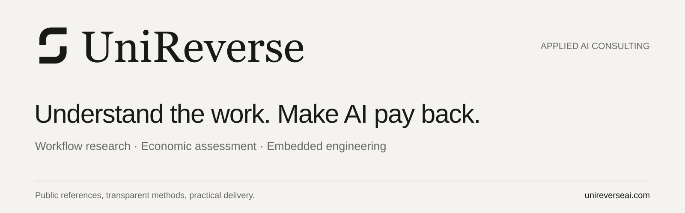

# UniReverseAI

Applied AI consulting and engineering for sales-to-production workflows.

We study how work gets done, examine the investment case and build around the people and systems already running the business.

## How an engagement runs

| Stage | What happens | Evidence you can inspect |
|---|---|---|
| **01 Understand** · AI Opportunity Audit | Interviews and short team sessions map how the work runs today, its baseline and who owns each decision. | [Pilot brief](https://github.com/Unireverse-ai/delivery-playbook/blob/main/docs/pilot-brief.md) |
| **02 Assess** · Value assessment | Capacity and cash are modelled separately, with explicit assumptions, scenarios and the cost of review and exceptions. | [Value model and calculator](https://github.com/Unireverse-ai/ai-value-assessment), [cash-flow method](https://github.com/Unireverse-ai/ai-value-assessment/blob/main/docs/cashflow.md) |
| **03 Build** · Sales-to-Production AI | The workflow is built into the systems already in use, with version-bound review, idempotency and failure recovery. | [Workflow reference](https://github.com/Unireverse-ai/sales-workflow-reference), [architecture](https://github.com/Unireverse-ai/sales-workflow-reference/blob/main/docs/architecture.md) |
| **04 Accept** · Acceptance and handover | Agreed evidence decides acceptance, and a named operating owner takes over. | [Acceptance checklist](https://github.com/Unireverse-ai/delivery-playbook/blob/main/templates/acceptance-checklist.md), [handover checklist](https://github.com/Unireverse-ai/delivery-playbook/blob/main/templates/handover-checklist.md) |
| **05 Operate** · Managed AI Operations | Monitoring, support and change, measured against the stage 01 baseline. The result scopes the next workflow. | [Operations runbook](https://github.com/Unireverse-ai/delivery-playbook/blob/main/templates/operations-runbook.md), [measurement plan](https://github.com/Unireverse-ai/delivery-playbook/blob/main/templates/measurement-plan.md) |

The evidence column links to method templates and synthetic references, not customer work. Each engagement produces its own evidence at every stage.

## Choose your review path

| Your role | Start with the evidence |
|---|---|
| **Business owner** · Is the investment case credible? | [Value model and calculator](https://github.com/Unireverse-ai/ai-value-assessment), [monthly cash-flow method](https://github.com/Unireverse-ai/ai-value-assessment/blob/main/docs/cashflow.md), and [measurement plan](https://github.com/Unireverse-ai/delivery-playbook/blob/main/templates/measurement-plan.md). Capacity and cash are measured separately. |
| **Technical reviewer** · Can we inspect and reproduce it? | [Run the workflow](https://github.com/Unireverse-ai/sales-workflow-reference), then inspect the [actual parser baseline](https://github.com/Unireverse-ai/sales-workflow-reference/blob/main/evaluations/baseline-report.md) and [evaluation method](https://github.com/Unireverse-ai/sales-workflow-reference/blob/main/docs/evaluation.md). |
| **Procurement / partner** · How is delivery specified? | [Five-minute buyer guide](https://github.com/Unireverse-ai/delivery-playbook/blob/main/docs/buyer-guide.md#procurement), then the [pilot scorecard](https://github.com/Unireverse-ai/delivery-playbook/blob/main/templates/pilot-evaluation-scorecard.md) and [handover](https://github.com/Unireverse-ai/delivery-playbook/blob/main/templates/handover-checklist.md). |

The repositories contain **synthetic references and delivery specimens**. They make methods and implementation choices inspectable. Customer results, live integrations and operating commitments require evidence for the specific engagement. The workflow's local scripted review does not authenticate a real person.

## Where we help

**AI Opportunity Audit** · **AI Sales Operations** · **Sales-to-Production AI** · **Managed AI Operations**.

An engagement defines the workflow, baseline, systems, decision authority, acceptance evidence and operating owner. Research & Business covers workflow investigation and quantitative assessment; Engineering covers implementation, integration, evaluation and handover within the agreed scope.

## Company and contact

UniReverseAI is the public brand of **Unireverse OÜ**, registered in Estonia under registry code [**17634890**](https://ariregister.rik.ee/eng/company/17634890).

[Business enquiries: Eric@unireverseai.com](mailto:Eric@unireverseai.com) · [Website: unireverseai.com](https://unireverseai.com)
